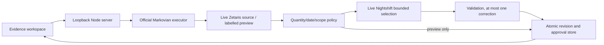

# Order Evidence

A local synthetic wholesaler order investigator for **The Agent That Can Explain Why**, Open Agent Hackathon 2026.

Working first build: inspect a promise, inventory and supplier evidence; investigate with the genuine Meterless Markovian executor; inspect cited source versions; approve a draft; apply a supplier update and see the earlier approval invalidated. Nothing sends messages, purchases stock or changes real orders.

## Current verification

- 38/38 native tests passed on Node 24.19.0, rechecked October 24. Tests include 20 exact classifications, 5 uncertainty cases, 10 supplier updates, idempotency, two process restarts, HTTP revision/approval safety, source-scope rejection and guarded source setup/update checks.
- Separate preview evaluation: 20/20 genuine Markovian runs completed; 20/20 classifications match sealed evaluator labels; 20/20 outputs reference existing immutable evidence records. Reference existence is not an independent semantic citation audit.
- Real browser check: investigate order 003, inspect citation, record an automated preview draft approval, apply U01, observe on-track revision 2 and invalidated historical approval. Keyboard traversal works; desktop 1440×900 and mobile 390×844 have 0 horizontal overflow. Mobile citation opens supplier v2.
- Real Zetaris source setup and retrieval passed October 23: 20/20 registered payloads deep-equal the fixed synthetic cases. An actual duplicate-container CREATE returned HTTP 400. See [source receipts](docs/evidence/zetaris-source-oct23.json).
- Real Zetaris U01 source update passed October 24: one guarded write changed the dedicated synthetic view, then all 20 payloads were verified with 20 retrieval receipts. The helper preserves the other 19 orders and existing record versions. See [U01 source receipts](docs/evidence/zetaris-u01-oct24.json).
- The live U01 workflow also passed: the same Order 003 investigation gained linked on-track revision 2, retained the original three records unchanged and added supplier v2 with October 25 arrival. The earlier automated demonstration approval was invalidated; revision 2 remains unapproved. Markovian completed in 31.617 seconds with one validated Nightshift call, 783 reported tokens and reported USD 0. This is one separate update demonstration, not additional matrix coverage or a ten-update live pass. See [live U01 evidence](docs/evidence/live-u01-oct24.json).
- Genuine Cursor desktop agent authored the U07 HTTP regression using included access. Dedicated test 1/1, Cursor's then-current suite 25/25, independently checked October 23 suite 27/27; the current suite is 38/38. Codex operated the desktop; no manual participant authorship claimed. See [provenance](docs/CURSOR_PROVENANCE_OCT23.md). Organizer announcement October 22 confirms no free Cursor credits are offered and Cursor is optional; no paid upgrade purchased.
- **A representative live investigation passed.** Real Zetaris retrieval and Nightshift Qwen2.5 1.5B selection drove a completed Markovian workflow in 23.374 seconds with 769 reported tokens and reported `actual_usd: 0`. A separate browser observation gave a 31.873-second upper bound, not an exact render time or a universal latency claim. [Actual workflow](docs/evidence/nightshift-first-live-oct23.json), [browser measurement](docs/evidence/live-browser-timing-oct23.json).
- **Full live matrix failed.** October 24 coverage is 17/20 distinct cases with exact classifications, real source/model/engine execution and valid record references; all 5 designated uncertainty cases passed. S18 failed with Nightshift HTTP 503 `engine_reloaded`, then timed out on the explicit manual continuation after a normal app restart. S19–S20 were not run. Across 19 attempts, 17 successful returned model calls reported 12,940 tokens and USD 0; usage/cost of the 2 failed calls is unknown. Successful investigation latency ranged 7.0–82.0 seconds; billing is not independently verified. The original [live report](evaluation/results/live.json) and [continuation](evaluation/results/live-continuation-oct24.json) remain failed. See the [campaign evidence](docs/evidence/live-campaign-oct24.json). No automatic product retry or uninterrupted reliability pass is claimed. The final entry was submitted with these limits disclosed.

## Run

Node 24.19+ in the 24 LTS series. No package installation required. The official vendored engine contains TypeScript parameter properties, requiring Node's experimental transform flag.

```sh
npm start
```

Open `http://127.0.0.1:4317`. The server listens on loopback only. Choose **Offline preview** to exercise the available workflow. Live remains the default and fails visibly when access is unavailable. No silent fallback.

```sh
npm test
node --experimental-transform-types scripts/evaluate.mjs
npm run check:live
```

`check:live` exits 1 until both actual source retrieval and authenticated Nightshift route discovery work. It does not claim that discovery proves inference. Evaluation labels live under `evaluation/ground-truth.json`, never served to the investigator. Preview results are under `evaluation/results/preview.json`.

After an on-device Nightshift model is ready, `node --experimental-transform-types --env-file=.env scripts/evaluate-live.mjs` runs the 20 real source/model investigations in an isolated temporary store. It writes `evaluation/results/live.json` after each case, stops on a transport failure and preserves returned attempt usage. A pass requires 20 real source/model/engine runs, at least 18 exact classifications, 20 citation checks and 5 uncertainty requests. This runner does not update sources, approve drafts or verify billing.

Source phases matter: the committed 17/20 live campaign and failed continuation used the fixed base view before U01. The current dedicated source now contains U01, so Order 003 is on track rather than its baseline at-risk label. Comparing that updated view blindly with the unchanged baseline evaluator labels would mix phases. No full matrix rerun was performed after U01; the later update proof is separate and historical reports remain unchanged.

## Demo workflow

1. Choose Order 003, Offline preview, Investigate. Status is at risk because confirmed arrival is later than the promise.
2. Open a cited source. Inspect source identity, version, observation/effective times and its actual fields.
3. Approve the draft. Approval applies only to that immutable revision.
4. Apply U01. Supplier version 2 arrives before the promise. Revision 2 is on track; revision 1 approval stays in history and becomes invalidated.
5. Re-investigate. The canonical order/mode investigation and changed evidence are retained; no duplicate revision is created.

Order 020 exposes a separate recovery-evidence step before U10 cancellation, allowing the recovery revision to be reviewed and approved first. All dates are an explicitly fixed synthetic business clock, distinct from actual request/save timestamps.

## Private live configuration

Copy `.env.example` to private `.env`, never commit it. Configure either the existing Zetaris account values or a private `ZETARIS_PLATFORM_ENV_FILE` path to the vendor distribution's existing `.env`. The app reads its admin email/password server-side, obtains a memory-only token and actual orgId, then uses the documented local UI proxy. It does not create an API key. No credentials are returned to the browser.

Nightshift requires its **Console Runtime token**, separate from a provider credential. The app discovers actual `meterless/*` and `webllm/*` routes, then requests a bounded JSON selection. For the tested M1-M4 build, set `METERLESS_MODEL` to the installed Qwen2.5 1.5B `webllm/*` ID returned by Runtime discovery. A concrete pin and one user message avoid Nightshift's routed duplicate-system-message error. Each completion requests `max_price: 0`, at most 256 output tokens and an 80-second deadline; discovery remains bounded to 8 seconds. Unsupported selections get at most one correction. Actual usage, receipt ID and reported routed model are retained. Cost uses Nightshift's reported `actual_usd` when present, with an explicit unverified-billing label; no independent billing claim or electricity estimate.

Each Runtime request uses a fresh `order-evidence:<UUID>` memory scope. Nightshift treats scope as a learned-answer namespace, not an authorization grant. Sharing its default user scope injected earlier answers into later orders. The isolated adapter returns the correct selections for previously failing Order 002 and Order 004; full live evaluation is assessed separately. [Isolation evidence](docs/evidence/nightshift-scope-isolation-oct23.json).

Endpoints use loopback only: Zetaris UI port defaults to 3300, Nightshift to 8088. Set the vendor's `UI_PORT`, `GUI_URL` and `ALLOWED_ORIGINS` consistently; the app reads `UI_PORT` from the private vendor file, with optional `ZETARIS_UI_PORT` override. Verify the selected listener belongs to Zetaris before enabling credentials. No arbitrary network destinations, SQL or file paths accepted through HTTP. Source view is `order_evidence.records`, holding one `order_id,payload` row per synthetic case. Current UI proxy uses POST `/api/proxy/sql-editor/sqls/run-query`, body `{sql,limit}`, response `{headers,data,total,timeUsed}`. Real source registration and parsing passed 20/20 October 23.

On a fresh, configured Zetaris installation, `npm run seed:zetaris` creates the fixed synthetic container/view and verifies all 20 returned payloads. Plain CREATE only: an existing container stops setup before view writes. This is intentionally not an overwrite or repair command. The local instance is already seeded; do not rerun setup there. It does not implement live source updates or prove a Nightshift investigation.

For the dedicated synthetic demonstration only, `node --env-file=.env scripts/update-zetaris-demo.mjs` applies the fixed U01 supplier update to the real source. It requires exactly 20 raw payloads matching the base fixtures before replacing this generated view, preserves 19 orders and existing record versions, and verifies all 20 afterward. An exact U01 retry performs no write; drift stops the command. Run with exclusive ownership of this local demo source, since preflight and replacement are not a transaction. Re-investigate Order 003 in Live mode afterward to review the linked revision and old approval invalidation. This helper accepts no arguments and cannot edit an arbitrary source.

## Architecture



Markovian drives retrieval and assessment callbacks, with explicit completed-state checks. Application state uses atomic file replacement and immutable identities; the reference engine's history is not treated as a durable business database. Concurrent mutation requests are serialized. File permissions restrict persisted data; `.env` and `data/` are ignored.

## Imported components and attribution

- Unmodified Meterless Markovian reference, commit `0aa7417ba5c826396d91e891328be78c45e6fbf6`, nine source files, Apache 2.0, predates the build window. License and source hashes in `vendor/meterless/`.
- UI adapts static Ledger layout structures from the participant's existing design-demos, disclosed in `docs/UI_PROVENANCE.md`. No pre-event app/business logic imported from that design reference.
- Local Geist fonts from Google Fonts, SIL Open Font License files under `public/fonts/`.
- Node built-ins only, no runtime npm dependencies. New app code authored during the eligible build window using Codex, with a bounded genuine Cursor-agent regression-test contribution October 23. Actual Runtime model use and its verification limits are recorded in `metadata.json`.

## Submission

**Submitted 1/1**, verified in HackOS after reload on October 24. The entry shows “The Agent That Can Explain Why Submitted” and Save Changes replaces Submit. The final 1,929-character description persisted. See the [submission receipt](docs/evidence/submission-receipt-oct24.json) and [confirmation screenshot](docs/evidence/submitted-oct24.jpg). The exact submission timestamp was not exposed. Existing failures remain recorded; no public deployment has been made.

The final [3:13 narrated screenshot walkthrough](https://iframe.mediadelivery.net/embed/778121/7ef4784a-f77f-4a4f-9c61-5bc78281de22) and [eight-slide deck](https://hackathon-server.genai.works/api/v1/cdn/proxy/hackathon/2405b06a26524e549e104b062607c3da.pptx) persisted after save and reload before submission. The walkthrough shows actual live UI, U01 revision history and approval invalidation; it is not continuous screen recording. Actual remote playback advanced beyond 27 seconds at 1920×1080 with no player error. The deck downloaded with HTTP 200, 61,438 bytes and an exact SHA256 match to the local export. Repository anonymous access is verified. See [current October 24 status](docs/BUILD_STATUS_OCT24.md), [final-media evidence](docs/evidence/final-media-oct24.json), the [October 23 historical status](docs/BUILD_STATUS_OCT23.md) and the [earlier draft media receipt](docs/evidence/submission-media-oct23.json).
