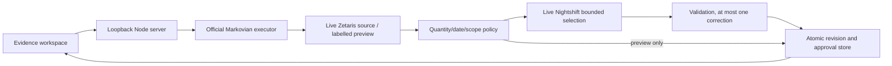

# Order Evidence

A local synthetic wholesaler order investigator for **The Agent That Can Explain Why**, Open Agent Hackathon2026.

Working first build: inspect a promise, inventory and supplier evidence; investigate with the genuine Meterless Markovian executor; inspect cited source versions; approve a draft; apply a supplier update and see the earlier approval invalidated. Nothing sends messages, purchases stock or changes real orders.

## Current verification

- 27/27 native tests passed on Node24.19.0. Tests include20exact classifications,5uncertainty cases,10supplier updates, idempotency, two process restarts, HTTP revision/approval safety, source-scope rejection and source setup checks.
- Separate preview evaluation:20/20 genuine Markovian runs completed;20/20 classifications match sealed evaluator labels;20/20 outputs reference existing immutable evidence records. Reference existence is not an independent semantic citation audit.
- Real browser check: investigate order003, inspect citation, record an automated preview draft approval, apply U01, observe on-track revision2 and invalidated historical approval. Keyboard traversal works; desktop1440x900 and mobile390x844 have0 horizontal overflow. Mobile citation opens supplier v2.
- Real Zetaris source setup and retrieval passed October23:20/20 registered payloads deep-equal the fixed synthetic cases. An actual duplicate-container CREATE returned HTTP400. See [source receipts](docs/evidence/zetaris-source-oct23.json).
- Genuine Cursor desktop agent authored the U07 HTTP regression using included access. Dedicated test1/1, Cursor's then-current suite25/25, independently checked current suite27/27. Codex operated the desktop; no manual participant authorship claimed. See [provenance](docs/CURSOR_PROVENANCE_OCT23.md). Organizer announcement October22 confirms no free Cursor credits are offered and Cursor is optional; no paid upgrade purchased.
- **A representative live investigation passed.** Real Zetaris retrieval and Nightshift Qwen2.5 1.5B selection drove a completed Markovian workflow in23.4s; browser result observed within31.9s. The first broader live evaluation stopped after5 cases:2 validated,2 rejected model selections,1 provider failure. Full acceptance and final media remain incomplete; this build is not submission-ready. [Actual workflow](docs/evidence/nightshift-first-live-oct23.json), [live report](evaluation/results/live.json).

## Run

Node24.19+ in the24LTS series. No package installation required. The official vendored engine contains TypeScript parameter properties, requiring Node's experimental transform flag.

```sh
npm start
```

Open `http://127.0.0.1:4317`. The server listens on loopback only. Choose **Offline preview** to exercise the available workflow. Live remains the default and fails visibly when access is unavailable. No silent fallback.

```sh
npm test
node --experimental-transform-types scripts/evaluate.mjs
npm run check:live
```

`check:live` exits1 until both actual source retrieval and authenticated Nightshift route discovery work. It does not claim that discovery proves inference. Evaluation labels live under `evaluation/ground-truth.json`, never served to the investigator. Preview results are under `evaluation/results/preview.json`.

After an on-device Nightshift model is ready, `node --experimental-transform-types --env-file=.env scripts/evaluate-live.mjs` runs the20 real source/model investigations in an isolated temporary store. It writes `evaluation/results/live.json` after each case, stops on a transport failure and preserves returned attempt usage. A pass requires20 real source/model/engine runs, at least18 exact classifications,20 citation checks and5 uncertainty requests. This runner does not update sources, approve drafts or verify billing.

## Demo workflow

1. Choose Order003, Offline preview, Investigate. Status is at risk because confirmed arrival is later than the promise.
2. Open a cited source. Inspect source identity, version, observation/effective times and its actual fields.
3. Approve the draft. Approval applies only to that immutable revision.
4. Apply U01. Supplier version2 arrives before the promise. Revision2 is on track; revision1approval stays in history and becomes invalidated.
5. Re-investigate. The canonical order/mode investigation and changed evidence are retained; no duplicate revision is created.

Order020 exposes a separate recovery-evidence step before U10 cancellation, allowing the recovery revision to be reviewed and approved first. All dates are an explicitly fixed synthetic business clock, distinct from actual request/save timestamps.

## Private live configuration

Copy `.env.example` to private `.env`, never commit it. Configure either the existing Zetaris account values or a private `ZETARIS_PLATFORM_ENV_FILE` path to the vendor distribution's existing `.env`. The app reads its admin email/password server-side, obtains a memory-only token and actual orgId, then uses the documented local UI proxy. It does not create an API key. No credentials are returned to the browser.

Nightshift requires its **Console Runtime token**, separate from a provider credential. The app discovers actual `meterless/*` and `webllm/*` routes, then requests a bounded JSON selection. For the tested M1-M4 build, set `METERLESS_MODEL` to the installed Qwen2.5 1.5B `webllm/*` ID returned by Runtime discovery. A concrete pin and one user message avoid Nightshift's routed duplicate-system-message error. Unsupported selections get at most one correction. Actual usage, receipt ID and reported routed model are retained. Cost uses Nightshift's reported `actual_usd` when present, with an explicit unverified-billing label; no independent billing claim or electricity estimate.

Each Runtime request uses a fresh `order-evidence:<UUID>` memory scope. Nightshift treats scope as a learned-answer namespace, not an authorization grant. Sharing its default user scope injected earlier answers into later orders. The isolated adapter now returns the correct selections for previously failing Order002 and Order004; full live evaluation must be rerun separately. [Isolation evidence](docs/evidence/nightshift-scope-isolation-oct23.json).

Endpoints use loopback only: Zetaris UI port defaults to3300, Nightshift8088. Set the vendor's `UI_PORT`, `GUI_URL` and `ALLOWED_ORIGINS` consistently; the app reads `UI_PORT` from the private vendor file, with optional `ZETARIS_UI_PORT` override. Verify the selected listener belongs to Zetaris before enabling credentials. No arbitrary network destinations, SQL or file paths accepted through HTTP. Source view is `order_evidence.records`, holding one `order_id,payload` row per synthetic case. Current UI proxy uses POST `/api/proxy/sql-editor/sqls/run-query`, body `{sql,limit}`, response `{headers,data,total,timeUsed}`. Real source registration and parsing passed20/20 October23.

On a fresh, configured Zetaris installation, `npm run seed:zetaris` creates the fixed synthetic container/view and verifies all20 returned payloads. Plain CREATE only: an existing container stops setup before view writes. This is intentionally not an overwrite or repair command. The local instance is already seeded; do not rerun setup there. It does not implement live source updates or prove a Nightshift investigation.

For the dedicated synthetic demonstration only, `node --env-file=.env scripts/update-zetaris-demo.mjs` applies the fixed U01 supplier update to the real source. It requires exactly20 raw payloads matching the base fixtures before replacing this generated view, preserves19 orders and existing record versions, and verifies all20 afterward. An exact U01 retry performs no write; drift stops the command. Run with exclusive ownership of this local demo source, since preflight and replacement are not a transaction. Re-investigate Order003 in Live mode afterward to review the linked revision and old approval invalidation. This helper accepts no arguments and cannot edit an arbitrary source.

## Architecture



Markovian drives retrieval and assessment callbacks, with explicit completed-state checks. Application state uses atomic file replacement and immutable identities; the reference engine's history is not treated as a durable business database. Concurrent mutation requests are serialized. File permissions restrict persisted data; `.env` and `data/` are ignored.

## Imported components and attribution

- Unmodified Meterless Markovian reference, commit`0aa7417ba5c826396d91e891328be78c45e6fbf6`, nine source files, Apache2.0, predates the build window. License and source hashes in `vendor/meterless/`.
- UI adapts static Ledger layout structures from the participant's existing design-demos, disclosed in `docs/UI_PROVENANCE.md`. No pre-event app/business logic imported from that design reference.
- Local Geist fonts from Google Fonts, SIL Open Font License files under `public/fonts/`.
- Node built-ins only, no runtime npm dependencies. New app code authored during the eligible build window using Codex, with a bounded genuine Cursor-agent regression-test contribution October23. Runtime model use remains outstanding, see `metadata.json`.

## Remaining before submission

Resolve the local Runtime's repeated-request failure and model-selection validation failures; complete live A01–A06, including changed evidence from the real governed source; revise the1–4minute video and8-slide draft deck from verified results; review final entry and submit. No public deployment has been made.

Submission preparation October23: HackOS draft saved with description/repository link, a3:01 narrated screenshot walkthrough and eight-slide draft deck. Uploaded media links persist and play/download correctly. Draft is not submitted. Repository is public with anonymous access verified; Nightshift inference and live proof remain open. See [current status](docs/BUILD_STATUS_OCT23.md) and [media receipt](docs/evidence/submission-media-oct23.json).
